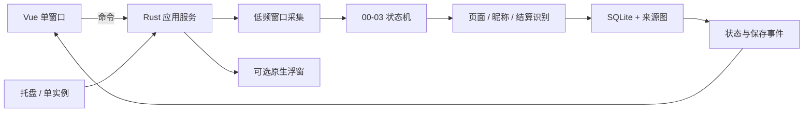

# 系统架构与关键决策

状态：现行　更新：2026-11-02

## 技术组成

| 层 | 技术/入口 | 职责 |
| --- | --- | --- |
| 桌面外壳 | Tauri 2，`rust-app/src-tauri/` | 单主窗口、托盘、单实例、应用生命周期、资源打包 |
| 前端 | Vue 3 + TypeScript，`rust-app/src/` | 自动记录、战绩、手动导入、设置和浮窗配置界面 |
| 业务核心 | Rust，`rust-app/src-tauri/src/` | 采集、页面状态、OCR 调度、自动流程、存储和系统集成 |
| 识别 | Windows OCR + Tesseract，或 PP-OCRv6 small | 按用户设置选择本地 OCR 引擎；不调用云端服务 |
| 持久化 | SQLite + 本机文件 | 战绩、设置、来源截图及临时调试日志 |

## Rust 模块边界

- `capture.rs`：目标窗口信息、低频 DXGI 采集和暂停条件。
- `automation.rs`、`settlement.rs`：自动记录生命周期、页面阶段和结算确认。
- `nickname.rs`、`nickname_ocr.rs`、`ocr.rs`、`ppocr.rs`、`imaging.rs`：昵称/数字识别及图像预处理。
- `storage.rs`：新版 SQLite、幂等保存、来源图和待保存恢复。
- `ocr_settings.rs`、`nickname_debug.rs`：识别设置和本地诊断日志。
- `auto_next.rs`：保存后的单次动作闸门、取消检查和按键发送。
- `overlay.rs`：原生 Display 浮窗；`desktop.rs`、`lib.rs`、`main.rs`：Tauri 组装、命令和生命周期。
- `Workspace.vue` 是主界面入口；前端通过 Tauri commands 请求操作、通过事件接收后台状态。Rust 持有真实业务状态，前端不得推测/另建一套采集状态。

## 生命周期与数据流

应用服务拥有监测任务；导航、收起窗口和查看历史不应另起采集任务。工作线程负责采集、OCR 和存储，避免阻塞界面。监测开始/停止和应用退出必须能清理对应线程、窗口与句柄。

## 数据、资源与隐私边界

- 新数据使用 Tauri `app_local_data_dir`，应用标识 `local.betterapex.rustlab`。战绩库、配置、来源图片与 `nickname-debug/` 在该目录下，细节以 `storage.rs` 当前实现为准。
- 根目录 `data/` 是开发机保留的旧数据，不是新应用的数据目录，也不是运行时依赖。旧数据库只允许用户显式请求时用兼容命令只读检查。
- PP-OCR 模型和 ONNX Runtime 位于 `rust-app/src-tauri/resources/`（构建产物，不入 Git）；可追踪的 Tesseract 字库及许可位于 `assets/tesseract/tessdata/`。Tesseract 原生 DLL 由资源准备脚本从本机 NuGet 缓存取得。
- 运行时不依赖 Python、GPU、云 OCR 或上传。正式交付必须带齐 `resources/` 及许可。
- 旧 WPF 源码已移除；迁移背景在 `archive/`。不为兼容旧代码而保留平行业务实现。

## 关键决策

| 决策 | 采用方式 | 原因/约束 |
| --- | --- | --- |
| 单一业务状态所有者 | Rust 服务；前端请求快照并接收状态事件 | 避免页面切换、恢复导致重复监测或状态漂移 |
| 本地优先、版本数据分离 | 新版独立 SQLite 和证据目录；不迁移旧数据 | 避免改写旧库，也明确数据所有权 |
| 未知值保留未知 | SQLite 空值表示未确认，0 表示真实零 | 不以猜测污染统计 |
| 低频捕获 | 常态 2 秒最多一帧，仅结算确认临时 1 秒 | 控制资源占用，不做连续录像 |
| 昵称证据独立于结算提示 | 自动身份来自同局 02；03 只提供不可信匹配线索 | 结算文字遮挡/误读时不能冒充身份 |
| 显式引擎选择 | 一个 worker 使用同一引擎，不静默混用 | 保证一次对局的识别来源可解释 |
| 自动下一局有动作闸门 | 完整自动保存后确认新鲜结算证据，再最多发送一次数字 1 | 不抢焦点；切出、停止或条件变化即取消 |

若新增跨模块架构决策，先更新本表；重大、可独立复用的决定可另建 ADR 并链接。
