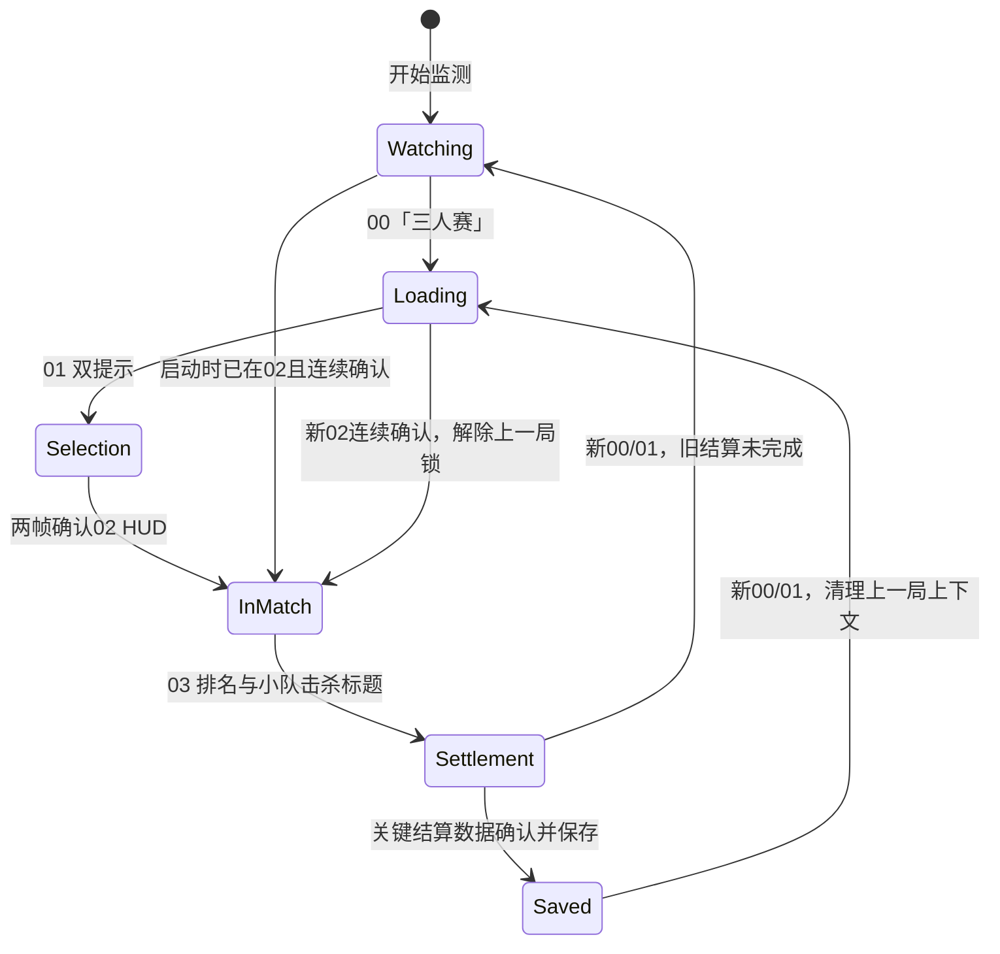

# 自动记录流程规范

状态：现行　更新：2026-11-02

本文件是 00→01→02→03 采集、保存和下一局边界的唯一现行行为规范。实现入口主要为 `automation.rs`、`settlement.rs`、`capture.rs`、`nickname.rs`、`storage.rs` 和 `auto_next.rs`。

## 对局状态

00、01、02、03 是页面/流程证据，不等同于比赛服务器状态。页面判定失去证据或采集暂停时不得伪造状态转换。

## 阶段行为

| 阶段 | 进入证据 | 处理规则 |
| --- | --- | --- |
| 00 加载 | 左上「三人赛」 | 建立新局候选；不读取战绩、不创建记录 |
| 01 选传奇 | 「小队静音」与「选择成为跳伞指挥官」同时出现 | 只监视阶段和新局边界；不读取昵称、不生成01名单或昵称图 |
| 02 对局 | 动态小队数量等HUD证据连续两帧成立 | 仅在确认帧从左下HUD读取一次三人昵称。空结果/错误也消耗本局唯一尝试；清理空白后保留原文，不投票、不重试。保存一张02来源图；切出恢复不重读 |
| 03 结算 | 「小队排名」和「小队总击杀」标题 | 读取排名、队伍总击杀和三人K/A/击倒/伤害；关键字段经连续新帧确认后保存。03昵称仅作不可信匹配线索 |

02 与 03 玩家位置可能不同，必须一对一关联。只有匹配证据足够时，最终自动昵称才使用02名单原文；不确定时保存数值和未知身份，不按位置、剩余人数或卡片文字补名。兼容字段 `voted_roster` 当前表示自动02名单，不表示运行了投票。

## 采样、确认与失败

- 常态 2 秒最多采一帧；03候选确认期间 1 秒最多一帧；处理慢时不补采积压帧。
- 结算排名和队伍总击杀未确认时不保存完整战绩。自动伤害要求两个有效新结算帧读数一致；未知/冲突最多追加3张新帧。超限后保留其他有效字段，伤害为空/待核对，不填0。
- PP模式下结算数字使用所选PP实例；不会因单字段失败静默混用另一数字引擎。相应输入、资源和校验见[OCR规范](OCR识别.md)。
- 数字稳定后，只有存在可信02名单时才在最终证据帧读取一次三张结算卡片匹配线索。读不到线索或匹配失败不阻止已确认数字保存；身份保持未知。
- 超过20秒没有新帧时只进入暂停提示并恢复常态节奏，保留本局资格、阶段证据和保存锁。恢复后的结算必须用两张新帧重新确认；身份连续性无法证明时不得沿用旧名单。

## 保存、防重与新局

- 一局最多保存一次。数据库事务成功后刷新前端历史、记录数量和最近一场；停留结算页、重复帧、重试和pending恢复不重复插入。
- 见到03后仍继续监视00/01。若新00/01先于旧结算保存出现，结束旧结算等待、丢弃旧名单并建立新局上下文；不为未确认数据补造战绩。
- 已保存结算锁在新00/01后仍保留，直到新02连续确认。切出/恢复、一次HUD误判或对局标记变化都不能单独解锁。
- 手动导入、重复/去重保存、pending恢复和含未知数字的记录不触发自动下一局。

## 保存后自动下一局

此功能默认开启，可在设置中关闭。只有自动流程完整确认排名、队伍总击杀、三人K/A/击倒/伤害且数据库首次保存成功后，才创建一次待执行动作。另需新鲜结算帧（1.5秒内）、结算页标题及可用的「重新匹配」提示；取消、匹配中或正在排队提示会拒绝动作。

发送前复查目标PID/句柄、前台、最小化、停止状态、开关及Ctrl/Alt/Shift/Win/数字1按住状态。不抢焦点，最多发送一次主键盘数字1（扫描码按下后50ms释放）。任一条件改变或10秒内失去有效画面即取消；失败不重按、不在用户返回后补按。界面/日志只能表示“已发送”，不能声称Apex已接收或已进入匹配。

## 可观察结果

临时 `nickname-debug/` 日志默认开启，记录实际OCR调用、空结果/错误、阶段、关联、保存ID与自动下一局取消/结果；不额外截图、不上传、不覆盖旧文件。日志故障不得阻止主流程。退出/切换规则、设置路径和测试范围见对应运行文档与验证记录。
