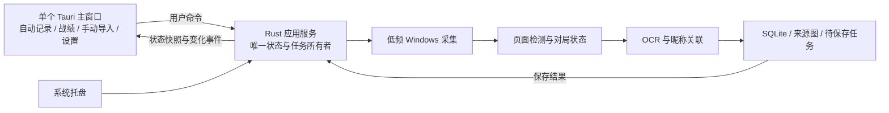

# Better Apex：Rust＋Tauri 技术与 UI 改造计划

日期：2026-10-31  
文档状态（2026-11-01 更新）：步骤 A/B、C1/C1b、C2/C3、D 自动监测及 E 托盘／单实例已接入。当前原图、规则、日志和来源约束共 26 项 Rust 测试及 3 项前端测试通过；昵称为 5 帧双来源＋10 帧 HUD 投票，严格作为唯一自动昵称来源。结算粗文字仅用于卡片对齐，不得兜底展示／保存姓名。临时日志、历史同步、状态事件、结算回退修复保持。无安装器运行版持续更新，实战准确率与性能仍待验收。  
适用范围：Windows x64 本地桌面版。开发、打包在当前电脑完成，游戏采集在另一台游戏电脑验收。

## 1. 改造目标与范围

本轮完成两个方向的改造：

1. 技术栈从 C#／.NET 10／WPF 迁移为 Rust＋Tauri 2，减少随包携带的运行库，建立可独立运行的本地后台核心。
2. 将导入识别、自动监测和历史记录整合到一个主窗口，形成统一导航、统一状态和一致的操作体验。

现有采集、OCR、昵称关联、按局记录和存储能力是迁移基线。改造过程中使用原图、固定输入和数据库副本对比行为；出现差异时先解释和修正，不顺带调整识别阈值或新局判断策略。

用户最新反馈：补测三局可正常记录，先前漏记可能因为没有打开结算页。本轮不将其列为已确认的“第二局切换故障”，也不加入此前排查中试写、随后撤回的新局判断规则。

本轮不扩展云端同步、排行榜、统计分析、自动操作游戏、开机自启或在线自动更新。现有手动入口继续保留，产品主路径以自动记录为中心。

数据策略按用户确认调整：Rust 新版从独立的空数据目录开始累积战绩，不提供旧版 `data/matches.db` 的导入、读取或迁移功能。
旧 WPF 版仍可单独查看旧记录；两版数据不会自动合并。

## 2. 当前基线与改造动机

当前主界面、采集界面和历史界面分别创建独立窗体。使用路径可能形成“打开工具 → 打开采集窗 → 打开历史窗”的三个窗口，状态与操作分散。

当前 2 秒版发布包的实测基线如下，体积单位为 MiB，1 MiB＝1,048,576 字节：

| 类别 | 解压后占用 |
| --- | ---: |
| .NET 核心运行时与基础库 | 78.52 |
| Windows 桌面运行库与资源 | 60.67 |
| Windows API 的 .NET 调用组件 | 24.23 |
| OCR 模型与 x64 识别库 | 23.80 |
| 同时附带的 x86 OCR 库 | 5.45 |
| SQLite、图形绑定、应用代码等其他文件 | 3.72 |
| 合计 | 约 196.39 |

ZIP 约 87.03 MiB。以上来自 `BetterApex-auto-record-dxgi-2s-20261031-140711` 发布产物，不包含用户战绩数据。

完整迁移后不再随包携带 .NET、WPF 和 Windows SDK 的 .NET 调用程序集。Rust 程序、前端资源和必要原生依赖会形成新的体积，不能直接用旧包减去 163 MiB 作为最终结果。

## 3. 新技术栈与职责

| 层次 | 计划选择 | 职责 |
| --- | --- | --- |
| 桌面应用外壳 | Tauri 2 | 单主窗口、托盘、应用生命周期、安装分发 |
| 界面 | Vue 3＋TypeScript＋Vite | 页面、导航、状态展示和用户交互；构建为本地静态资源 |
| 后台核心 | Rust | 采集调度、识别协调、对局状态、关联、存储、设置 |
| Windows 系统接口 | 微软 Rust for Windows 接口绑定 | DXGI、窗口信息、Windows OCR、必要的 WGC 兼容能力 |
| OCR | Windows OCR＋Tesseract | 迁移现有图像预处理及解析流程，沿用已验收模型 |
| 数据库 | SQLite，使用 rusqlite | 由 Rust 管理新版记录结构、连接和事务；新版使用独立数据目录 |
| 前后端通信 | Tauri commands＋events | 用户命令、状态快照、保存结果；图像按需传输 |

上述为选型方向。实施时验证 Windows 10 兼容性，再固定 Rust 工具链、依赖版本及锁文件。Node.js 只作为前端开发构建工具，不随正式应用分发。

最终正式版不保留 C# 后台进程或 .NET sidecar。旧版可保留为独立对照版本，用于回归和回退；迁移中间产物需明确标注，不能把混合运行的过渡包当作 Rust 版完成。

## 4. 后台架构与生命周期

核心约束：

- 应用进程拥有唯一监测服务，页面组件不拥有采集任务。切换页面、查看详情或收起主窗口，不重建或停止监测。
- Rust 保存真实状态。前端打开、恢复或重新加载后先请求完整状态快照，再接收事件；不能依赖前端自己推测“是否正在记录”。
- 开始、停止命令可重复调用且结果一致。连续点击开始、重复启动程序，不产生第二个监测任务。
- 第二次打开程序唤起现有主窗口；同一数据目录仍需互斥保护，防止新旧程序同时自动记录。
- 截图、OCR、图片编码和数据库写入放在后台工作线程；不阻塞 UI 事件循环。
- Direct3D 上下文由采集线程管理；WinRT 对象按线程和 apartment 要求使用，避免未经验证地跨线程传递。
- 队列有上限。识别繁忙时保留必要证据，丢弃过期普通帧，不积压整局画面。

建议将后台按 `capture`、`detector`、`recorder`、`ocr`、`association`、`storage`、`app_state` 划分。Tauri 命令层负责调用这些模块，业务模块可以在无界面测试中运行。

## 5. 现有能力的迁移规则

### 5.1 采集与调度

- 默认继续采用 DXGI 显示器复制，在 GPU 上裁出选定游戏窗口的客户区，再回读需要的区域。
- 常规采集间隔保持 **2 秒**，处理变慢时不补赶积压帧。
- 结算确认临时每 1 秒最多采样一帧，采样新帧与上一次结果核对；保存或离开结算页后恢复 2 秒。昵称采样同样短时提升到 1 秒，详见阶段 D。
- 保留游戏前台、最小化、遮挡、尺寸变化、目标窗口退出及设备异常的处理规则。默认 DXGI 切出后暂停，返回后恢复。
- WGC 为显式选择的兼容路径，保留系统版本和黄框行为提示。
- 默认收起预览。只有用户展开且窗口可见时，使用已采集帧生成预览；不为 UI 预览额外截图。

### 5.2 OCR 与对局处理

- 昵称继续使用 Windows OCR，结算解析继续沿用现有 Windows OCR／Tesseract 分工。
- 先验证调用现有 x64 Tesseract 原生库的可行性，保留当前模型与版本，检查 UTF-8、返回值、内存释放及运行库依赖。
- 迁移预处理、区域计算、数字分组、字段校验和昵称一对一匹配；使用目录中的原始样本比对，不用聊天缩略图标定。
- 未识别字段保持未知；真实的 0、昵称未确认和本人未确认继续分别表达。
- 昵称稳定后停止本局重复昵称识别。普通检测只分析必要的小区域。
- 新局边界、同局锁定、待核对任务、重启重试和保存键沿用当前规则。跨局数据不可复用。
- 工具仍需要看到三人结算“总结”页才能获取完整数据。界面清楚提示这一使用条件，不自动点击游戏切换页面。

### 5.3 新版 SQLite 与文件存储

Rust 版建立独立的 SQLite 结构与数据目录，不读取或改写旧版数据库、`automation-state.json` 或待处理任务。旧版用户数据保留在
旧版应用目录中；用户若继续查看旧记录，仍使用旧版程序。

Windows 版使用 Tauri 的 `app_local_data_dir` 建立新版数据目录，在其中创建 `matches.db`；来源图放入同目录下的证据子目录，数据库只保存相对路径。当前应用标识为 `local.betterapex.rustlab`，因此目录与旧版项目目录中的 `data/matches.db` 分离。旧版数据不导入、不读取、不覆盖。

数据库以 SQLite `user_version` 标记结构版本。首版包含 `matches`、`players`、`match_images` 三张表：数值未知使用 `NULL`，真实 0 保留为 0；`is_local` 可空表示本人身份未知；昵称确认状态单独保存；玩家槽位固定为 0–2；来源图类型记录选传奇图或结算图。外键在删除对局时级联处理其玩家与来源图记录。后续结构变化须增加显式迁移，不直接重建或覆盖现有用户数据。

## 6. UI 信息架构：只保留一个主窗口

主窗口默认进入“自动记录”。左侧固定导航，右侧展示当前页面，顶部或底部保留全局监测状态。

| 导航 | 主要内容 | 主要操作 |
| --- | --- | --- |
| 自动记录 | 游戏连接、当前阶段、本场名单、最近保存结果 | 开始监测／停止监测 |
| 战绩记录 | 新版保存列表、选中记录的数据与来源图 | 选择记录、查看详情 |
| 手动导入 | 结算／局内昵称导入、识别、关联、保存 | 选择截图、识别、关联、保存 |
| 设置 | 采集模式、数据位置、版本与运行依赖状态 | 修改现有配置、打开数据目录 |

“战绩详情”属于战绩页的内部内容；“查看来源图”使用主窗口内的图片查看层。以上操作不创建新桌面窗口。

系统文件选择器和必要的系统安装提示可以作为系统对话框出现。正常使用流程不得再出现主界面、监测和历史三个独立窗体。

## 7. 页面与操作设计

### 7.1 自动记录页

将主要信息按使用顺序组织：

1. 顶部状态卡：是否发现 Apex、是否正在监测，以及唯一主操作按钮。
2. 本场进度：等待入局 → 读取昵称 → 等待结算 → 正在保存 → 已保存。当前阶段突出，已完成阶段弱化。
3. 本场名单：三人昵称及确认状态；尚未识别时说明原因，不用空白卡片占位。
4. 最近保存：时间、排名和小队击杀，点击在同一主窗口切到对应战绩。
5. 可展开的“画面预览与采集详情”，供排查时使用。

已有窗口匹配能力优先找到 Apex，显示“已发现 Apex”；手动选择放进展开区。没有发现游戏时显示“未发现 Apex，请先启动游戏”，提供“重新检测”，不创建无目标采集会话。发现目标后由用户点击“开始监测”，不默认自动启动。

第一次使用在页面内展示简短说明：工具与游戏在同一电脑运行；点击开始后切回游戏；结算时打开三人总结页，首测建议停留至少 4 秒。说明可收起并在帮助位置重新查看。

### 7.2 战绩记录页

- 宽窗口采用列表与详情两栏；窄窗口进入站内详情视图并提供返回，保留列表位置。
- 列表优先显示保存时间、排名、小队击杀和昵称，当前选中项清晰可见。
- 详情先展示三人数据，再展示来源截图。截图按需加载，不一次解码全部历史图片。
- 自动保存后更新列表及数量，不要求用户每次手动刷新；保留刷新作为主动操作。
- 新战绩到达时不抢走用户正在看的旧记录，在页面内提供“查看新记录”。
- 本阶段不增加统计大屏、复杂图表或新的数据筛选功能。

### 7.3 手动导入页

复用现有操作能力，将流程顺序显示清楚：导入 → 识别 → 关联（可选）→ 保存。

结算识别和局内昵称是页内模式切换，不弹新窗。按钮随当前草稿状态出现，避免未识别就看到一排不可用操作。取消文件选择保留已有草稿；切换页面也保留未保存内容。

手动草稿与自动监测的本局上下文分开管理，手动“新对局”不能清空正在监测的一局。手动与自动保存仍使用统一去重规则。

### 7.4 设置页

首版只集中已有设置和必要的程序信息：默认采集方式、固定 2 秒常规间隔说明、实际数据目录、应用版本、WebView2／OCR 依赖状态及日志入口。

DXGI／WGC 等术语放在采集详情或设置说明中。主流程使用“开始监测”“等待结算”“已保存”等玩家能直接理解的文字。

## 8. 窗口、托盘与退出规则

| 操作 | 预期行为 |
| --- | --- |
| 切换页面或查看详情 | 后台监测持续，主窗口数量不变 |
| 最小化 | 正常最小化，监测状态保持 |
| 监测中点击关闭 | 收起到托盘；首次用非模态提示说明“仍在后台监测” |
| 未监测时点击关闭 | 正常退出；有未完成保存时先展示进度，有未保存手动草稿时通过页内确认层一次性提示 |
| 托盘点击“打开主界面” | 恢复同一窗口及当前页面 |
| 托盘开始／停止 | 调用同一个后台服务，菜单与主窗口状态同步 |
| 托盘明确“退出程序” | 停止取帧，完成或持久化已捕获任务；有未保存手动草稿时恢复主窗口完成页内确认，再退出进程 |
| 重复启动程序 | 唤起现有窗口，不新建第二个实例 |

托盘在窗口收起前必须建立成功；失败时保留可操作窗口，不能让程序“消失”。托盘菜单包含当前状态、打开主界面、开始／停止监测、退出程序。

前台原生窗口数量为 1，不代表整个应用只有一个进程。WebView2 的子进程需计入内存与 CPU 测量。

## 9. 视觉与可用性

视觉方向为简洁的深色桌面工具：深灰背景、分层表面、低饱和辅助色和少量珊瑚红主操作色，延续 Better Apex 的识别度。

- 采用系统中文字体，不附带大体积字体包；正文与数字保持清楚的层级和对齐。
- 同页只突出一个主要操作。导航位置固定，返回行为可预期。
- 状态同时使用文字与图标，不能只靠红绿颜色表达。
- 优先展示结果、下一步与异常原因，不把 OCR 原始文字、置信度或算法参数放进主页面。
- 空状态分别说明“暂无战绩”“未找到游戏”“等待结算”，不能统一显示为空白。
- 运行中的非致命异常在原页面提示，不用连续消息框打断游戏；关键结果不抢焦点。
- 支持键盘导航、清晰焦点、Esc 关闭页内图片查看层和可辨识的按钮文本。
- 建议初始窗口约 1180×780，最小约 900×650；在 100%／125%／150%／200% 缩放下检查布局，不固定假设只有 2K 桌面。
- 使用少量短过渡，避免持续动画、大范围模糊背景和动态粒子装饰。

## 10. 性能与前后端边界

体积下降、UI 现代化和游戏运行性能分别验收，不互相代替。

1. 常规取帧仍由 Rust 的单调时钟调度，每 2 秒最多一次。切换页面或重新订阅事件不能触发额外采集。
2. 监测与 OCR 使用有界后台工作线程，按既有策略降低线程优先级，复用 GPU 与识别资源。
3. 前端以状态变化事件驱动，不使用高频轮询刷新整个界面。
4. 图片预览关闭或窗口不可见时，停止缩略图编码、图像 IPC 和预览绘制；不把整张 2K 图持续转成 Base64 发给前端。
5. 截图按记录 ID／受控资源路径按需读取，数据库和任意文件系统操作集中在 Rust；前端只具备已声明的必要能力。
6. 列表按需加载，来源图缓存有上限；长时间运行不累计旧帧、WebView 事件监听器和缩略图。
7. 本地静态页面和系统字体随应用加载，正常识别与看历史不依赖 CDN 或网络请求。

验证同时记录 Rust 主进程和 WebView2 子进程的总 CPU、内存、GPU、磁盘写入，以及游戏 FPS／帧时间。重点对比：未监测、稳定局内监测、结算解析、托盘隐藏、查看历史图片等场景。

实际游戏测试在游戏电脑执行，与无工具及旧版 2 秒采样做同机对比；对可复现的额外卡顿或性能下降先定位，不以“Rust 理论上更快”作为通过依据。界面隐藏时后台采集仍持续，不能用停止采集换取好看的性能结果。

## 11. 发布、体积与运行依赖

当前开发与验收使用无安装器的直接运行目录，避免每次测试都解压：`.local/BetterApex-Rust-AutoRecord/BetterApex-Rust-AutoRecord.exe` 与同目录 `resources/` 必须一起保留。用户已要求后续不再制作 ZIP。正式发布是否提供 Setup，留到运行依赖与安装流程完成后再定。

- 使用系统已有的 Evergreen WebView2 Runtime。安装时检测存在性与所需版本，缺失或版本不足时提供引导安装；默认不捆绑完整固定版本运行环境。
- WebView2 缺失且电脑离线时明确说明安装条件；如需全离线安装包，作为单独的大包发布并标注。
- 检测 Windows OCR 简体中文组件和 Tesseract 所需原生运行库。WebView2 已安装不等于 OCR 所有依赖均已满足。
- 正式包只带 x64 所需文件、当前识别模型及必要资源，不带 .NET、Node.js、开发 SDK、调试符号、测试原图或用户数据。
- 保留第三方依赖和模型许可说明。安装更新保留数据；卸载默认保留用户战绩，并明确其位置。

当前临时日志版无安装器运行目录实测约 36.37 MiB，其中 EXE 约 12.08 MiB、`resources/` 约 24.29 MiB；EXE 和 7 个资源文件哈希一致，实际启动和日志开关检查通过。它不包含用户数据，也不包含目标电脑可能需要单独安装的 WebView2 或 Windows OCR 语言组件。早期 ZIP／Setup 体积属于设计估算；当前按用户要求不生成 ZIP，安装版留待后续决定。

## 12. 实施顺序与逐步验收

按可独立运行的里程碑交付；实现时连续完成相互依赖的小项，并运行本机可完成的编译与有限测试。只有需要游戏电脑实测或确需用户判断的事项才暂停请求协助。

| 步骤 | 工作与交付物 | 通过标准 |
| --- | --- | --- |
| A：兼容性与体积原型 | 最小 Tauri 窗口；Rust 在独立测试中验证 DXGI、Windows OCR、Tesseract 和 SQLite 读写能力；产出测试包与组成清单 | Windows 10 游戏电脑能启动；实际 2K 帧完整；原图识别与本地存储能力可检查；明确真实包体积及依赖 |
| B：单窗口交互原型 | 四个导航页、页内详情与图片查看层；可先用明确标注的演示数据 | 全流程只有一个主窗口；布局、文字、按钮和导航经用户检查；演示状态不会误报为真实采集 |
| C1：结算字段识别 | 手动导入结算图，结构化识别排名、小队击杀及三名玩家 K/A/击倒/伤害 | 字段按数值输出；未识别保留“待核对”；昵称与本人归属未自动确认 |
| C1b：入局昵称证据 | 读取选传奇界面左上队伍栏和底部玩家栏；两处各由 Windows OCR、Tesseract 读取，规范化后按完全相同文本投票；平票优先 Windows OCR | 一张 2560×1440 原图三名建议与标注一致；第三名实际为单路候选，不能标成已确认；不确认本人或跨画面关联 |
| C2：新版数据和历史 | 独立数据目录、版本化 SQLite、记录保存、列表与详情、来源图、重复保存去重 | 已完成；定向存储测试通过，未知与 0、昵称/本人状态和两类来源图正确保留；不导入旧版数据 |
| C3：手动关联和完整流程 | 暂存选传奇截图昵称，逐位置关联结算玩家，手动修正/确认并保存 | 已接入；未确认内容保持待核对，当前内存暂存需在导入同局结算前完成；需要游戏电脑目视验收 |
| D：自动监测迁移 | 已接入 00→01→02→03、常规 2 秒／短时 1 秒 DXGI、结算校验、SQLite 去重及恢复；昵称为 5 帧双区域＋10 帧 HUD 投票，03 粗线索只做一对一对齐，保存层拒绝无来源昵称；临时日志和中断修复保持 | Rust 26 项及前端 3 项测试通过；连续实战、昵称准确率与性能需游戏电脑验收；详见阶段 D 说明 |
| E：托盘和生命周期 | 已接入托盘开始/停止/退出、监测中关闭收起、托盘重新打开，以及 Windows 单实例激活；主窗体启动和重复启动转发已在发行版通过检查 | 托盘菜单及监测中关闭收起仍需交互验收；实际游戏采集中退出恢复待游戏电脑整体验收 |
| F：发布和性能验收 | 正式安装程序、独立数据目录说明及性能对比报告 | 干净环境安装和新版数据保存可验证；不覆盖旧版数据；体积和运行资源实测；游戏电脑无未解决的可复现性能回退 |

旧 WPF 程序与历史发布包在迁移期间保留，供查看旧记录及作为运行基线。Rust 版使用独立数据目录，从空数据库开始记录；两版可并存，且互不读写对方的数据。

## 13. 最终验收清单

| 方向 | 验收结果 |
| --- | --- |
| 单窗口 | 自动记录、战绩列表、详情、截图和手动识别均在一个主窗口内完成 |
| 操作路径 | 打开工具后能清楚找到开始入口，监测状态持续可见，查看战绩不影响监测 |
| 技术迁移 | 正式运行无需启动 C# 后台，不携带 .NET／WPF 程序运行库 |
| 功能等价 | 现有标注样本、昵称匹配、保存、去重和待核对规则通过回归；不将旧 I/l 歧义算作新识别准确率 |
| 数据边界 | 新版从空数据开始记录；旧版数据留在旧版应用内，不导入、不覆盖 |
| 采集频率 | 实测常规帧间隔符合 2 秒约束，额外校验受限，切出后不采集其他前台窗口 |
| 游戏流程 | 游戏电脑连续至少三局，显示结算的场次正常保存；未进入结算页不伪造战绩 |
| 运行体验 | 托盘不抢焦点、开始与停止无歧义、无重复实例和持续增长的缓存 |
| 体积与性能 | 提交实测数据并注明包含的依赖，安装包大小和系统组件占用分别报告 |

大厅、加载、地图、观战等时序测试按明确标注的原图或可控回放执行；缺少真实原图时必须标注合成用例，不把回放通过描述为实战全覆盖。

## 14. 本轮设计结论与下一步

### 2026-10-31 续开发核对

本轮完成计划 7.2／10 中的自动保存历史同步与状态事件通知：新记录到达不抢走旧详情，窗口恢复补读状态；托盘文字直接跟随后台更新。对应的有限原图、状态通知、存储和前端同步测试均通过。

随后修复交付构建缺少 `custom-protocol` 导致打开开发地址报连接拒绝的问题。正式构建统一使用 `scripts/Publish-RustPortable.ps1`；已在无 Vite 开发服务器条件下实际启动交付目录 EXE，核对内置页面地址和首页／战绩页。以后编译、资源哈希及交付目录启动检查同时作为交付条件。

最新结算反馈已定位到无新帧 20 秒分支清空入局资格与 UI 文字推断阶段：现已改为保留对局状态、独立暂停提示和阶段枚举，并增加结算后禁止无入场证据的 HUD 回退。反馈附件可识别为第 9 名／小队 5 击杀；合成序列验证中断恢复后保存一次且不带入身份未确认的旧名单。实际取帧中断原因仍需游戏电脑证据，不能据此声称所有实战漏记已消除。

2026-11-01 按用户确认扩大昵称样本：01 阶段 5 秒／最多 5 帧、每帧双区域，02 确认 HUD 后 10 秒／最多 10 帧，每人最多 20 份读数。先整体匹配玩家，再按完整写法计票，结合不同帧、来源、占比和领先幅度决定是否给出建议；修正保留早期／较长错字的旧规则。只增加有界文字样本，每阶段仅留一张证据图，自动线程复用 OCR 实例；不积压帧、不无期限加密检测。新增规则由合成读数和原图回归验证，仍不等同于实战准确率验收。

随后按用户复盘要求增加临时文字日志，默认开启，在新版数据目录的 `nickname-debug/` 每次运行新建 TXT＋JSONL，保留所有实际昵称 OCR、空结果／错误、融合与投票、待核对原因、映射、关联和保存 ID。设置页提供本次运行开关及打开目录；不上传、不覆盖、不自动清理，不额外截图或重复识别。日志失败不阻止主流程，旧版本未保存样本不能追补。24 项 Rust 与 3 项前端测试通过。

按用户纠正，再次明确身份来源：01／02 投票名单决定最终自动昵称；03 只提供数值与卡片粗匹配线索。已移除自动关联、存储层和手动界面的结算文字兜底，把结算字段改为 `nickname_hint`，注释显式标识 voted_roster／manual／unresolved。无来源的旧 pending 只保留数值，未能匹配的卡片保留未知身份，不补全剩余人数；原有历史不据截图猜测批量改写。新增合成回归证明 vjkook 的 188 伤害仍归到投票昵称，旗帜杂字不进入展示或保存名字。

计划内尚未完成的工作按依赖分为：

1. 开发机可继续实现：未保存手动草稿的退出确认、退出期间保存进度与非阻塞收尾、首次收至托盘的说明，以及设置页运行依赖检测与数据目录/日志入口。当前关闭与退出行为仍以阶段 E 的已实现规则为准，不能视为设计表格全部完成。
2. 需要游戏电脑证据：连续至少三局、结算停留与下一局、未进入结算、切出/最小化和窗口中断恢复、监测中托盘隐藏/退出，以及 FPS、帧时间与资源对比。开发机测试不代替这些验收。
3. 后续发行：干净环境依赖与 Windows 10 兼容验收；正式安装器按用户偏好暂缓，仅维护 EXE＋resources 直接运行目录。

完成本轮同步改动后，下一项开发优先处理退出保护与保存收尾，避免手动草稿丢失，并让实际退出过程可见；不在缺少实战证据时继续调整页面阈值或新局规则。

当前采用 Rust＋Tauri 2＋Vue 3＋TypeScript。界面统一为一个主窗口，后台任务由 Rust 应用服务持有，识别与自动记录使用新版独立存储。新版不提供旧版战绩导入或读取。

步骤 A/B、C1/C1b、C2/C3 已接入；D 自动监测通过有限原图闭环测试；E 托盘和单实例激活已实现，直接运行目录已整理。发行版主窗体启动及第二次启动转发到原实例并退出已通过；托盘菜单和监测中关闭窗口收至托盘尚未手动确认。之后做一次游戏电脑整体验收，不因每个小改动暂停。实战 FPS、真实连续局状态和特定驱动问题仍须在运行 Apex 的电脑观察。本机继续做构建、原图 OCR、存储和状态机有限测试，不做无意义的重复试错。

## 15. 技术依据

以下为技术能力依据；本文中的具体页面、边界、分工及指标是针对本项目的设计选择。

- Rust Windows 系统接口采用微软提供的接口绑定，覆盖 C 风格、COM 和 WinRT API：[Rust for Windows](https://github.com/microsoft/windows-rs)。
- 构建环境需区分开发机的编译工具与用户机运行条件：[Tauri Prerequisites](https://v2.tauri.app/start/prerequisites/)。
- WebView2 的安装检测、引导与离线分发方式：[Tauri Windows Installer](https://v2.tauri.app/distribute/windows-installer/)。
- Windows 11 与大多数 Windows 10 设备已有运行时，但应用仍需检查：[微软 WebView2 分发说明](https://learn.microsoft.com/en-us/microsoft-edge/webview2/concepts/distribution)。
- 托盘作为统一应用生命周期的一部分实现：[Tauri System Tray](https://v2.tauri.app/learn/system-tray/)。
- 前端能力与原生命令权限按窗口和用途配置：[Tauri Capabilities](https://v2.tauri.app/security/capabilities/)。
